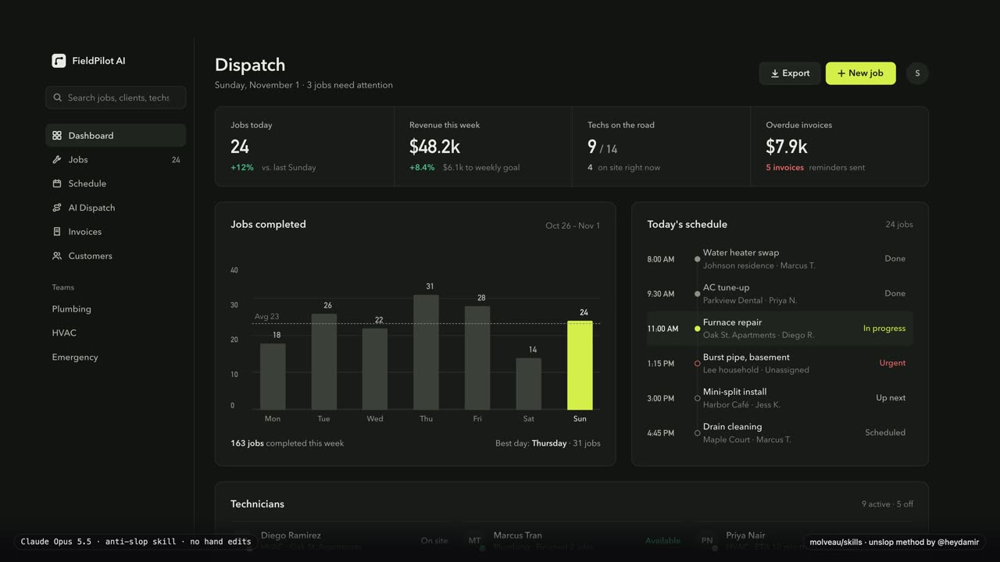

# Molveau skills

Sixteen agent skills from [Molveau Studio](https://www.molveau.ca/?utm_source=github&utm_medium=readme&utm_campaign=skills), a web studio in Montréal. Thirteen of them cover a domain (anti-slop, UI, motion, UX, French typography, Law 25, professional advertising rules, bilingual Next.js, SaaS, showcase sites, paid booking, local AI visibility, writing) and route to the best material on it; two more are a deep design audit and an inspiration index; the last one is the delivery workflow that ties them together. Most of the domain material comes from other authors' open skills, kept in this repo as pinned, unedited copies and checked against upstream every week. Four skills are Molveau's own research, not material from other authors: professional advertising rules, paid booking, local AI visibility and bilingual Next.js. You install one skill instead of a dozen, and the work is split by task, so the agent opens the right file instead of loading everything.

## See it work

[](examples/fieldpilot-unslop/video.mp4)

A dashboard vibecoded by Claude Sonnet, unslopped by Claude Opus with the `anti-slop` skill in one run, video included. No hand edits to anything the skill produced: the prompts, both files, the story and the run notes are in [`examples/fieldpilot-unslop/`](examples/fieldpilot-unslop/run.md). More on [molveau.ca/skills](https://www.molveau.ca/skills?utm_source=github&utm_medium=readme&utm_campaign=skills).

## The skills

| Skill | What it does | Merges | Script |
|---|---|---|---|
| `anti-slop` | Removes the AI-generated look from a UI and sets a direction; lists 20 tells | unslop (Damir Sokolovsky), taste-skill (Leonxlnx) | `detect-tells` |
| `ui` | Build, restyle, polish, critique and redesign interfaces; UI prompt pack | Jakub Krehel, Paul Bakaus (Impeccable), Emil Kowalski (taste guide) | none |
| `motion` | Decide, build, review and audit animation, with guardrails | Emil Kowalski, GreenSock, Raphael Salaja, LottieFiles, Benji Taylor | `check-motion` |
| `ux` | Interface copy, resilience, edge cases and accessibility | Jakub Krehel, Paul Bakaus (Impeccable), ibelick | none |
| `french-typography` | Fixes and checks French (Québec and France) spacing, guillemets and apostrophes | Molveau only | `fr-typo` |
| `loi-25-website` | Audits a website against Québec's Law 25; general information, not legal advice | Molveau only | none |
| `saas` | Playbook for a SaaS or app UI: what it needs, and which skills to apply in what order | Molveau only | none |
| `vitrine` | Playbook for a local business showcase site | Molveau only | none |
| `writing` | Removes the AI-written sound from English and French prose (README, docs, copy, email): 11 tells, a checker and a rewrite method | Molveau only | `check-writing` |
| `design-grill` | Deep read-only design audit: seven lenses (tokens, craft, motion, layout, accessibility, copy, heuristics) and one ranked report. Uses Claude Code's Workflow tool and several agents, so it costs more; a manual fallback is documented. Runs only when you type `/design-grill` | Molveau only | `merge-findings` and three helpers |
| `design-inspiration-index` | Routes a need (hero, navbar, CTA, motion, icons, brand) to the best public gallery or registry | Molveau only | none |
| `workflow` | How to deliver with a coding agent: clarify, plan, test first, one implementer and one reviewer per task, verify, git hygiene, status and result reports; routes each step to the skills above | Molveau only | none |
| `ordre-pro-advertising` | Advertising rules for the site of a Québec regulated professional (lawyer, mortgage or real estate broker, inspector, psychologist, physician), with a pass, fix or n.a. report per rule; not legal advice | Molveau only | none |
| `paid-booking` | Paid booking for a professional's or studio's site: deposit or full payment, no-show fees, refund and receipt policy, a safe form and a Stripe test-mode check | Molveau only | none |
| `local-ai-visibility` | Gets a small local business found and cited by ChatGPT, Perplexity, Claude, Copilot and Google AI Overviews, with a checker for the site | Molveau only | `check-ai-visibility` |
| `bilingual-next` | next-intl setup for a French and English Next.js site: localized URLs, hreflang and x-default, a language switcher that keeps the page, and a check that FR and EN messages match | Molveau only | `check-i18n-parity` |

How each skill compares with the other open skills on its subject, and when to install the original instead: [`anti-slop`](https://www.molveau.ca/guides/anti-slop-skills-compared?utm_source=github&utm_medium=readme&utm_campaign=skills), [`ui`](https://www.molveau.ca/guides/ui-design-skills-compared?utm_source=github&utm_medium=readme&utm_campaign=skills), [`ux`](https://www.molveau.ca/guides/ux-accessibility-skills-compared?utm_source=github&utm_medium=readme&utm_campaign=skills), [`motion`](https://www.molveau.ca/guides/motion-animation-skills-compared?utm_source=github&utm_medium=readme&utm_campaign=skills), [`design-grill`](https://www.molveau.ca/guides/design-audit-skills-compared?utm_source=github&utm_medium=readme&utm_campaign=skills), [`design-inspiration-index`](https://www.molveau.ca/guides/design-inspiration-skills-compared?utm_source=github&utm_medium=readme&utm_campaign=skills), [`workflow`](https://www.molveau.ca/guides/agent-workflow-skills-compared?utm_source=github&utm_medium=readme&utm_campaign=skills), [`french-typography`](https://www.molveau.ca/guides/french-typography-skills-compared?utm_source=github&utm_medium=readme&utm_campaign=skills), [`loi-25-website`](https://www.molveau.ca/guides/law-25-website-skills-compared?utm_source=github&utm_medium=readme&utm_campaign=skills), [`saas`](https://www.molveau.ca/guides/saas-ui-skills-compared?utm_source=github&utm_medium=readme&utm_campaign=skills), [`vitrine`](https://www.molveau.ca/guides/local-business-website-skills-compared?utm_source=github&utm_medium=readme&utm_campaign=skills).

## Install

All sixteen, with the [skills CLI](https://github.com/vercel-labs/skills) (Claude Code, Codex, Cursor and other agents that read `SKILL.md`):

```sh
npx skills add molveau/skills                  # all sixteen, in this project
npx skills add molveau/skills -g               # all sixteen, for every project
npx skills add molveau/skills -s anti-slop     # just one
```

Or one bundle:

| Bundle | Skills CLI |
|---|---|
| Design | `npx skills add molveau/skills -s anti-slop -s ui -s ux -s motion -s design-grill -s design-inspiration-index -s writing` |
| Québec | `npx skills add molveau/skills -s french-typography -s loi-25-website -s ordre-pro-advertising -s bilingual-next` |
| Playbooks | `npx skills add molveau/skills -s saas -s vitrine -s workflow -s paid-booking -s local-ai-visibility` |

In Claude Code, all sixteen as one plugin, with the commands, agents, MCP server and hook described below:

```
/plugin marketplace add molveau/skills
/plugin install molveau-skills@molveau
```

The scripts have no dependencies and run on Node 20 or newer. After installing, call them from the skill folder, for example:

```sh
node <skill folder>/scripts/detect-tells.mjs src/
node <skill folder>/scripts/check-motion.mjs src/
node <skill folder>/scripts/fr-typo.mjs --check messages/fr.json
node <skill folder>/scripts/check-writing.mjs README.md docs/
```

Each `SKILL.md` documents the options.

## MCP server

The same checks, plus the playbooks, as six tools for any MCP client. No dependencies and read-only: it reads the skills' own files and, when asked, files inside the folder it runs in, and it makes no network request.

| Tool | What it does |
|---|---|
| `detect_tells` | Scans a snippet, or files and folders inside the working directory, for the anti-slop tells; returns `path:line  #N label  match` lines, a summary and the count |
| `check_contrast` | WCAG contrast of a text colour on a background (hex, `rgb()`, `oklch()`, `oklab()`, `color(srgb)`), with the AA and AAA thresholds for that size and weight |
| `fr_typo` | Checks French spacing and punctuation in a text, or returns it fixed with the number of changes |
| `check_writing` | Flags AI-sounding prose in English or French (stock openers, filler, hedging, inflated words), with line, column and rule |
| `check_motion` | Runs the motion guardrails on a snippet |
| `get_playbook` | A skill's direction gate or "Do this first" block, or the playbook sections that match a query |

In Claude Code, the plugin (`/plugin install molveau-skills@molveau`) starts the server for you: nothing else to install.

Other clients run it from npm, with Node 20 or newer. Claude Code without the plugin:

```sh
claude mcp add molveau-skills -- npx -y @molveau/skills
```

Claude Desktop (`claude_desktop_config.json`), Cursor (`.cursor/mcp.json`) and other clients that read an `mcpServers` block:

```json
{
  "mcpServers": {
    "molveau-skills": {
      "command": "npx",
      "args": ["-y", "@molveau/skills"]
    }
  }
}
```

`detect_tells` with `paths` reads only inside the folder the client starts the server in (usually the project), follows no link out of it, skips `node_modules`, `.git`, build folders and tests, and stops at 2,000 files of 1 MB at most.

### Hosted endpoint (Streamable HTTP)

`@molveau/skills/core` answers MCP messages without starting a process, so a web route can serve the same tools over Streamable HTTP. Importing it reads no stdin and starts nothing.

```js
import { handleRpc, bundledFiles } from '@molveau/skills/core';

handleRpc(message, { remote: true }); // the reply, an array of replies for a batch, or null for a notification
```

| Option | Default | Effect |
|---|---|---|
| `remote` | `false` | `true` for a hosted endpoint: `detect_tells` takes only `code` and `filename` (no `paths`), string arguments over 200,000 characters are a tool error, and `get_playbook` leaves out the lines that point at the studio |
| `cwd` | `process.cwd()` | Folder `detect_tells` `paths` resolve in (local mode only) |
| `readFile` | read beside the module | `(path) => string \| null` serving the files `bundledFiles()` lists, by their path in the package, for a runtime with no file system |

A Next.js route (Node.js runtime) answers each `POST` with `handleRpc(await request.json(), { remote: true })`: the reply as JSON with status 200, or status 202 and no body when it returns null. Cap the request body size in the route: the 200,000-character limit applies to each argument, not to a whole request or batch. `options.remote` must be `true` or `false`; any other value throws, so a typo never falls back to local mode. `get_playbook` reads the skills' `SKILL.md` and playbook files at run time, so keep the package unbundled and its files traced:

```js
// next.config
serverExternalPackages: ['@molveau/skills'],
outputFileTracingIncludes: { '/api/mcp': ['./node_modules/@molveau/skills/skills/**'] },
```

## Commands and agents

The Claude Code plugin adds four commands and two read-only agents on top of the skills. Each one runs a skill's own process, so the result matches what the skill's `SKILL.md` describes.

| Command | What it does |
|---|---|
| `/molveau-skills:unslop <file, folder or URL>` | The full `anti-slop` run without stopping for approval: the direction is written at the top of the report, and the original is kept in `unslop-before/` as the before |
| `/molveau-skills:story-video <before> <after>` | Builds and renders the story video for a before and after pair, Accessibility step included (needs Playwright and ffmpeg in the project) |
| `/molveau-skills:fr-check [paths] [fix]` | Runs `fr-typo` on the given paths, or on the project's French message files and `*.fr.md`; fixes only when you add `fix`, and reports what changed |
| `/molveau-skills:loi-25-audit <folder or URL>` | The `loi-25-website` audit with its pass, fix and n.a. report. Not legal advice |

| Agent | What it does | Tools |
|---|---|---|
| `molveau-skills:ui-reviewer` | Design and UX review of the given files with `ui`, `ux` and `anti-slop`; runs the tells detector and returns ranked findings with `file:line` and the exact fix | Read, Grep, Glob, Bash |
| `molveau-skills:loi-25-auditor` | Law 25 audit of a site's code with `loi-25-website`; returns the skill's report | Read, Grep, Glob |

Claude delegates to an agent when the task fits its description, or you name it: `@agent-molveau-skills:ui-reviewer review app/page.tsx`. The skills CLI installs the skills only; the commands and agents come with the plugin.

## Hook

`anti-slop/scripts/hook-check.mjs` is a Claude Code `PostToolUse` hook. After each edit it checks the one file just written: UI code (`.tsx`, `.jsx`, `.ts`, `.js`, `.css`, `.html`, `.vue`, `.svelte`) with `detect-tells`, and French message files (`fr.json`, `*.fr.json`, `fr/*.json`, `*.fr.md`) with `fr-typo` when the `french-typography` skill is installed beside it. Findings go back to the agent, which fixes them or says why one is intended. A clean file, any other file and any error in the hook itself let the edit through in silence.

The plugin ships it on by default. To turn it off, open `/config` and switch off "Check edited files" under the plugin's options (or run `/plugin configure molveau-skills@molveau`).

With the skills CLI instead of the plugin, nothing registers it for you. To use it in a project where the skills CLI installed the skills, add this to the project's `.claude/settings.json`:

```json
{
  "hooks": {
    "PostToolUse": [
      {
        "matcher": "Edit|Write|MultiEdit",
        "hooks": [
          {
            "type": "command",
            "command": "node \"$CLAUDE_PROJECT_DIR\"/.claude/skills/anti-slop/scripts/hook-check.mjs"
          }
        ]
      }
    ]
  }
}
```

For a global install (`npx skills add molveau/skills -g`), point the command at `~/.claude/skills/anti-slop/scripts/hook-check.mjs` instead, or at wherever your agent keeps the `anti-slop` folder.

## How updates work

`sources.json` pins every upstream repo to a commit. The copies under `skills/*/references/vendor/` are never edited by hand, except each `references/vendor/README.md` (credits, Molveau's own); Molveau's own words live in each `SKILL.md`, `scripts/` and the playbooks.

```sh
node scripts/sync-sources.mjs --check          # does any pinned repo have newer commits?
node scripts/sync-sources.mjs --bump           # re-vendor at the latest commits; then read the diff
```

A weekly GitHub Action runs the check and keeps one open issue, "Upstream skills moved", listing each moved source with a compare link. A bump is always reviewed by a person before it is committed. GitHub pauses scheduled workflows after 60 days without repository activity; re-enable it from the Actions tab if that happens. `npm test` runs the scripts' tests and checks that every skill is well formed.

## Usage numbers

Installs per skill, from the skills CLI's anonymous telemetry, are public on [skills.sh/molveau/skills](https://skills.sh/molveau/skills). GitHub keeps traffic for 14 days only; maintainers archive it with `node scripts/stats.mjs` (needs the GitHub CLI with push access; the archive stays local in `stats/`).

## Credits

None of this exists without the people who wrote the originals. Thank you:

- [Damir Sokolovsky](https://github.com/heydamir/unslop) for unslop (CC BY 4.0)
- [Leonxlnx](https://github.com/Leonxlnx/taste-skill) for taste-skill
- [Emil Kowalski](https://github.com/emilkowalski/skills) for the animation and design engineering skills
- [GreenSock](https://github.com/greensock/gsap-skills) for the GSAP skills
- [Raphael Salaja](https://github.com/raphaelsalaja/skill) for 12 principles of animation
- [LottieFiles](https://github.com/LottieFiles/motion-design-skill) for motion-design
- [Benji Taylor](https://github.com/benjitaylor/skills) for stageshow
- [Jakub Krehel](https://github.com/jakubkrehel/skills) for better-ui and its siblings, and [make-interfaces-feel-better](https://github.com/jakubkrehel/make-interfaces-feel-better)
- [Paul Bakaus](https://github.com/pbakaus/impeccable) for Impeccable (Apache-2.0), which itself bundles material from [ehmo](https://github.com/ehmo/platform-design-skills)
- [Julien Thibeaut (ibelick)](https://github.com/ibelick/ui-skills) for fixing-accessibility
- Rauno Freiberg ([devouringdetails.com](https://devouringdetails.com)) and Suganthan Mohanadasan ([suganthan.com](https://suganthan.com)), whose published work is distilled, in Molveau's own words, into the `ui` skill's animation and discoverability references

Exact repos, commits and licenses are in [THIRD_PARTY.md](THIRD_PARTY.md), and each vendored folder keeps its own LICENSE and a `SOURCE.md`.

Notes:

- unslop is CC BY 4.0. The credit is repeated in `skills/anti-slop/references/vendor/README.md` and `THIRD_PARTY.md`. The vendored copy is partial (a few files are excluded, listed in its `SOURCE.md`) and its files are unmodified. The parts of unslop adapted in `skills/anti-slop/SKILL.md` stay CC BY 4.0; Molveau's other files are MIT.
- Some stageshow examples are left out because they embed or replicate third-party logos and product marks. The reason for each exclusion is in the stageshow `SOURCE.md`. Its kit still includes phone glyphs adapted from Apple's iOS UI kit, traced macOS cursors and SF Symbols-style icons; check them before reusing in a product.
- 12 principles of animation is pinned to its last published version: upstream archived the skill in October 2026 and removed it.

Good skills that this repo links to instead of merging:

- [Matt Pocock's skills](https://github.com/mattpocock/skills) and [Superpowers](https://github.com/obra/superpowers) go deeper on process (grilling, planning, TDD, debugging, code review); the `workflow` skill points to them as optional.
- [ui-ux-pro-max](https://github.com/nextlevelbuilder/ui-ux-pro-max-skill) is a searchable design database with a large footprint; install it on its own if you want it.

## Guides

How we use these skills on client work, on molveau.ca:

- [The Claude skills stack](https://www.molveau.ca/guides/claude-skills-stack)
- [The UI prompt pack](https://www.molveau.ca/guides/ui-prompt-pack)

French versions live under `/fr/guides/`.

## License

Files written by Molveau are MIT, copyright 2026 Stanislas Molveau (see [LICENSE](LICENSE)). Vendored files keep their own licenses, listed in [THIRD_PARTY.md](THIRD_PARTY.md).
